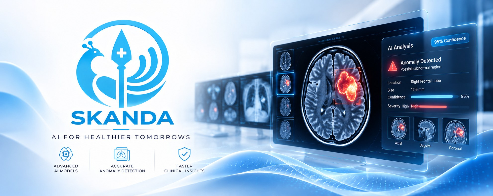
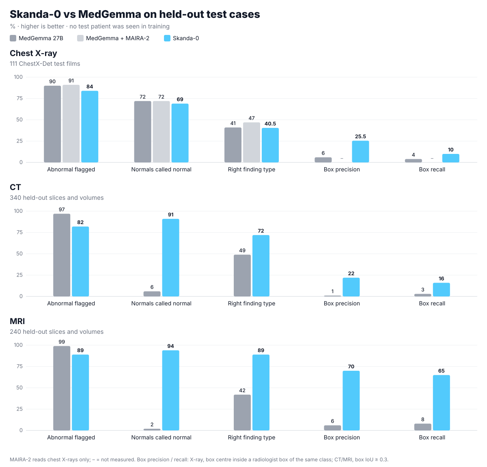
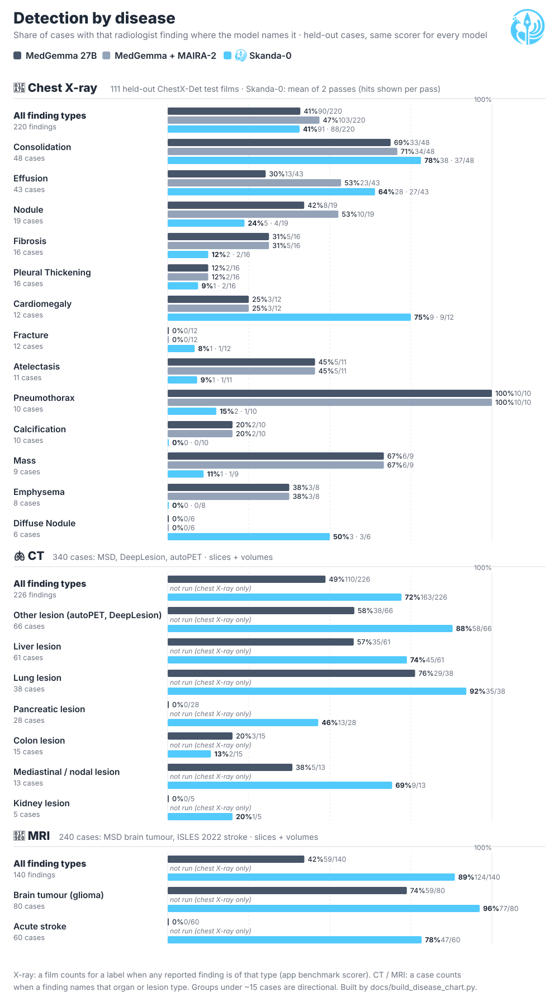
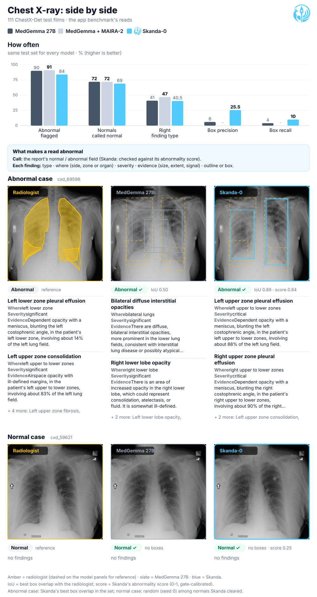
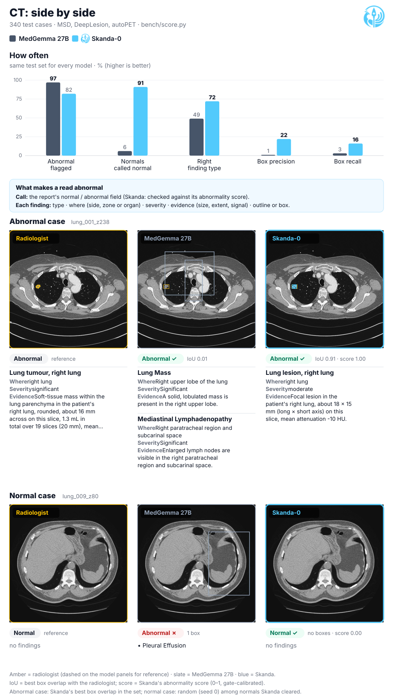
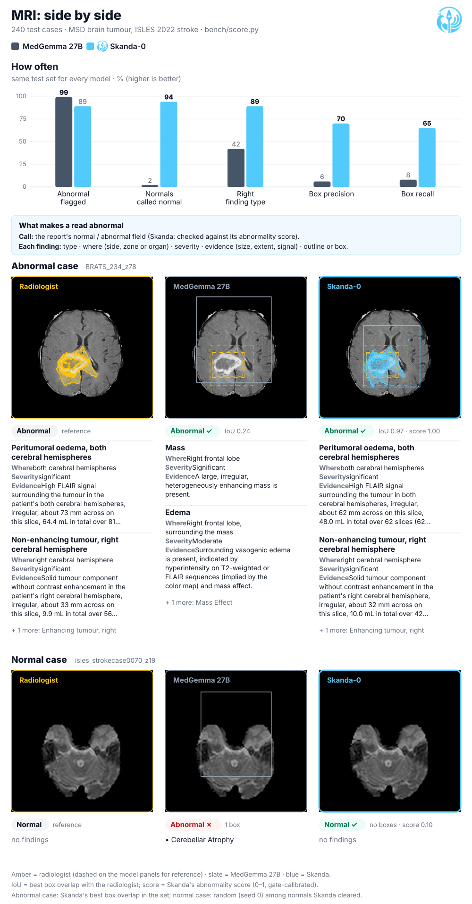

<div align="center">



# Skanda grounding

### One model that reads chest X-ray, CT and MRI, writes the report, and **outlines every finding it reports**

[](https://huggingface.co/hitheshkaranth/Skanda-0)
[](https://huggingface.co/Qwen/Qwen3-VL-30B-A3B-Instruct)
[-0EA5E9?style=flat-square)](https://huggingface.co/ByteDance/Sa2VA-Qwen3-VL-4B)
[](#-benchmark)
[](LICENSE)

[Skanda-0](#-skanda-0) · [How it works](#-how-it-works) · [Architecture](#%EF%B8%8F-architecture) · [Training](#%EF%B8%8F-training) · [Your own data](#-train-on-your-own-data) · [Benchmark](#-benchmark) · [Use it](#-use-skanda-0) · [Licences](#%EF%B8%8F-licences)

</div>

> [!WARNING]
> **Research use only.** Skanda drafts findings for a radiologist to review. It is not a medical device and has not
> been cleared or approved for clinical use by any regulator.

This repository is the source code of the **Skanda-0** grounded radiology model: the model definition, the training
pipeline and losses, dataset builders, evaluation and the inference server. The weights are on Hugging Face.

---

## 🤗 Skanda-0

| | |
|---|---|
| **Weights** | [`hitheshkaranth/Skanda-0`](https://huggingface.co/hitheshkaranth/Skanda-0) (bf16, 62.6 GB) · [`Skanda-0-int8`](https://huggingface.co/hitheshkaranth/Skanda-0-int8) (32.8 GB) · [`Skanda-0-int4`](https://huggingface.co/hitheshkaranth/Skanda-0-int4) (18.2 GB) |
| **What it is** | Qwen3-VL-30B-A3B-Instruct (mixture of experts, ~3B active parameters per token) + SAM 2.1 Hiera-L, joined by a `[SEG]` token |
| **Input** | a chest X-ray, a CT or MRI slice, or a CT/MRI volume (33 slices) |
| **Output** | a JSON report (`skanda-report/2`) and one outline per finding, plus p(abnormal) and 13 X-ray class scores |
| **Training data** | ChestX-Det, NIH ChestX-ray14, CheXmask, Medical Segmentation Decathlon, ISLES 2022, DeepLesion, autoPET: only datasets whose licences allow commercial use |
| **Weights licence** | CC BY-NC 4.0 (see the model card) |

---

## 🧠 How it works

<p align="center"></p>

1. **Read.** Qwen3-VL looks at the image and writes a JSON report, word by word.
2. **Point.** Every finding's `"mask"` field holds a special `[SEG]` token. The model's last hidden state *at that
   token* is its idea of "the thing I am describing now" (the idea comes from LISA).
3. **Outline.** A small projector turns that state into a prompt for SAM 2's mask decoder, which draws the outline.
   Sa2VA had already trained this SAM 2 to take such prompts.
4. **Score.** A linear head on the last prompt token gives p(abnormal) and 13 X-ray class scores. They write a short
   "likely / possible …" hint line before X-ray reports and drive a calibrated gate that can overrule a wrong
   normal/abnormal call.
5. **Explain.** Every number in a finding's `evidence` (side, zone, extent, size in mm, volume in mL, HU) was measured
   from radiologist masks during training, so the model learns to describe the region it outlines.

<details>
<summary><b>Example output</b></summary>

```json
{
  "normal": false,
  "findings": [
    {
      "title": "Effusion, right",
      "evidence": "Homogeneous opacity at the patient's right costophrenic angle, lower zone, about 18% of the right lung field, rounded upper margin.",
      "location": "right lower zone",
      "severity": "moderate",
      "mask": "[SEG]"
    }
  ],
  "impression": "Right pleural effusion."
}
```

Each `"mask": "[SEG]"` becomes one outline; a finding's box is its outline's extent.
</details>

---

## 🏗️ Architecture

| Part | Source | Size | Trained | Licence |
|---|---|---|---|---|
| Vision encoder | Qwen3-VL-30B-A3B-Instruct | ViT, 27 blocks | LoRA on the last 11 blocks + mergers | Apache-2.0 |
| Language model | Qwen3-VL-30B-A3B-Instruct | 48 layers, 128 experts (8 active), 31 B total / ~3 B active | LoRA r=64 on attention q/k/v/o; the `[SEG]` embedding and output rows | Apache-2.0 |
| Outline model | SAM 2.1 Hiera-L, weights from Sa2VA-Qwen3-VL-4B | ~224 M | mask decoder and its object score; image encoder frozen | Apache-2.0 |
| `[SEG]` projector | new | MLP 2048 → 2048 → 256 | from scratch | this repo |
| Score head | new | linear 2048 → 1 + 13 | from scratch | this repo |

- **`[SEG]` token:** id 151669, already inside Qwen3-VL's padded vocabulary. Its input and output rows train at 20×
  the learning rate; every other row's gradient is zeroed, so the rest of the vocabulary is untouched.
- **Images:** up to 1024² for both Qwen3-VL and SAM 2. Volumes: 32 evenly spaced slices + the key slice at 320² for
  Qwen3-VL; SAM 2 decodes each `[SEG]` on the slices. CT is rendered from HU as lung / soft-tissue / bone windows in
  R / G / B; MRI as up to three sequences; patient right on image left.
- **Code:** `skanda/model.py` (model and losses), `skanda/sam2.py` (SAM 2 with language prompts, from Sa2VA),
  `skanda/assemble.py` (builds the untrained model from the two base checkpoints).

---

## 🏋️ Training

```
loss = text cross-entropy (JSON boilerplate tokens × 0.3)
     + 2.0 × outline BCE + 0.5 × outline Dice          one per [SEG], against the radiologist mask (3D Dice for volumes)
     + 0.2 × object-score BCE                           does the target mask exist (on this slice)?
     + 0.5 × score-head BCE                             p(abnormal) + 13 X-ray classes; unknown labels skipped
```

| Stage | Trains | Data | Settings |
|---|---|---|---|
| **0 · Connector** | projector, SAM 2 mask decoder, score head | "Outline the *heart / right lung / liver lesion* …" → `[SEG]` | lr 1e-4 |
| **1 · 2D SFT** | + LoRA on language model and vision encoder, `[SEG]` rows | reports on X-rays and CT/MRI slices, with hint lines | lr 5e-5, r=64 |
| **2 · 3D volumes** | same | CT/MRI volumes with lesion-free volumes, 40% 2D replay | lr 5e-5 |
| **3 · X-ray polish** | same | X-ray reports, 15% 3D replay | lr 1.5e-5 |

Batch 1 × accumulation 8, AdamW, OneCycle (3% warm-up), grad-clip 1.0, bf16, gradient checkpointing. SAM 2's frozen
image encoder runs once into a feature cache (~8 MB per image). Rare findings are drawn more often (inverse
square-root class frequency). Each stage is kept only if its validation numbers are not worse than the best checkpoint
so far; reinforcement learning (GRPO) was tried in earlier runs and dropped by that check because it pushed the model to
call every X-ray abnormal. Skanda-0 is the third training run; each run started from the previous one's best checkpoint.

Full details: [docs/TRAINING.md](docs/TRAINING.md).

## 📚 Train on your own data

Records are JSON Lines: an image, the prompt, the target report as a JSON string with one `[SEG]` per finding, and one
binary mask PNG per `[SEG]` in the same order. Volumes add 33 slice images and a `masks.npz`.

```bash
pip install -r requirements.txt
hf download hitheshkaranth/Skanda-0 --local-dir checkpoints/skanda-0
hf download ByteDance/Sa2VA-Qwen3-VL-4B --local-dir checkpoints/sa2va
python -I skanda/cache_sam.py --sa2va checkpoints/sa2va --data data/mine/sft_*.jsonl --out cache/sam
python -I skanda/train.py --init checkpoints/skanda-0 --stage 1 --train data/mine/sft_train.jsonl \
    --val data/mine/sft_val.jsonl --out runs/stage1 --sam-cache cache/sam --vision-lora --hints
python -I skanda/evaluate.py --model runs/stage1/final --data data/mine/sft_test.jsonl --out runs/eval
```

[docs/TRAINING.md](docs/TRAINING.md) has the full record format (2D, connector, volume and label-only records), the
training from scratch, calibration and evaluation. `skanda/data/build_cxr.py` (ChestX-Det) and
`skanda/data/build_msd.py` (Medical Segmentation Decathlon-style NIfTI) are worked examples. `skanda/registry.py` is
the licence gate the builders use: add your dataset there with its licence.

---

## 🏁 Benchmark

All numbers are percentages on **held-out test cases**; no test patient was seen in training.

<p align="center"></p>

| 🩻 Chest X-ray · 111 films | MedGemma 27B | MedGemma + MAIRA-2 | **Skanda-0** |
|---|---:|---:|---:|
| Abnormal flagged | 90 | **91** | 84 |
| Normals called normal | **72** | **72** | 69 |
| Right finding type | 41 | **47** | 40.5 |
| Box precision | 6 | – | **25.5** |
| Box recall | 4 | – | **10** |

| 🫁 CT · 340 cases | MedGemma 27B | **Skanda-0** |
|---|---:|---:|
| Abnormal flagged | **97** | 82 |
| Normals called normal | 6 | **91** |
| Right finding type | 49 | **72** |
| Box precision | 1 | **22** |
| Box recall | 3 | **16** |

| 🧠 MRI · 240 cases | MedGemma 27B | **Skanda-0** |
|---|---:|---:|
| Abnormal flagged | **99** | 89 |
| Normals called normal | 2 | **94** |
| Right finding type | 42 | **89** |
| Box precision | 6 | **70** |
| Box recall | 8 | **65** |

<sub>Higher is better; **bold** = best. MAIRA-2 reads chest X-rays only. Box precision / recall: X-ray, a predicted
box counts when its centre lies inside a radiologist box of the same class; CT/MRI, box IoU ≥ 0.3 with a radiologist
outline, matched one-to-one. X-ray: ChestX-Det test films, one runner and scorer for every model, Skanda the mean of two
passes. CT and MRI: a fixed sample of held-out slices and volumes (MSD, ISLES 2022, DeepLesion, autoPET), with and
without lesions, every model scored by the same script. Read 1 Nov 2026.</sub>

- 🫁🧠 **CT and MRI:** Skanda-0 names the right finding 72% / 89% of the time (MedGemma 27B: 49% / 42%) and clears
  91% / 94% of lesion-free cases, where MedGemma calls nearly every case abnormal (6% / 2%).
- 🎯 **Outlines:** Skanda-0 draws outlines; the baselines write box coordinates as text. Its box precision is 4×
  MedGemma's on X-ray, 22× on CT and 12× on MRI.
- 🩻 **Chest X-ray is the weak side.** MedGemma flags more abnormal films and, with MAIRA-2, names the finding type
  more often. 111 films move each number by about ±10 points by chance.

### 🦠 Detection by disease

<p align="center"></p>

| | Skanda-0 leads | MedGemma 27B leads |
|---|---|---|
| 🩻 **X-ray** | consolidation 78% vs 69% · effusion 64% vs 30% (53% with MAIRA-2) · cardiomegaly 75% vs 25% · diffuse nodule 50% vs 0% | pneumothorax 100% vs 15% · atelectasis · nodule · mass · fibrosis · emphysema |
| 🫁 **CT** | lung 92% vs 76% · liver 74% vs 57% · pancreas 46% vs 0% · mediastinum 69% vs 38% | colon 20% vs 13% |
| 🧠 **MRI** | brain tumour 96% vs 74% · acute stroke 47 of 60 found vs 0 | – |

<sub>Groups under about 15 cases (kidney, mediastinum, colon, most rare X-ray labels) are directional only.</sub>

### 💬 Closed-question VQA

Yes/no and multiple-choice radiology questions, greedy decoding, scored on the first option named in the reply.

| Benchmark | Questions | Qwen3-VL-30B-A3B (untuned) | **Skanda-0** | Harrison.rad.1 (company-reported) |
|---|---:|---:|---:|---:|
| VQA-RAD test, closed | 251 | **77.7** | 77.3 | 82 |
| RadBench, closed (Radiopaedia cases) | 210 | **66.7** | 64.8 | 73 |
| SLAKE test, English yes/no | 355 | **83.9** | 82.0 | – |

<sub>Skanda-0 was not trained on question answering; these show it kept its backbone's general radiology knowledge
(within 2 points). Harrison.rad.1's figures are from Harrison.ai's own reports, not re-run here.</sub>

### 🔍 Side by side

The same held-out image read by each model, with the radiologist's outline. The cases are picked by a fixed rule that
favours Skanda (abnormal: Skanda's best box overlap; normal: a random lesion-free case it cleared), so they show what a
good read looks like; the bars above show how often one happens.

<details open><summary><b>🩻 Chest X-ray</b></summary>
<p align="center"></p>
</details>
<details><summary><b>🫁 CT</b></summary>
<p align="center"></p>
</details>
<details><summary><b>🧠 MRI</b></summary>
<p align="center"></p>
</details>

### ⚠️ Limitations

- **Rare X-ray findings are weak:** pneumothorax is named on 15% of the films that have it. Do not use it for triage.
- **It misses findings:** X-ray box recall is about 10%, CT 16%.
- **CT outlines can follow enhanced vessels** instead of the lesion.
- **Small, internal test sets** from the training sources; no external test set, reader study or radiologist review.
- **Template reports:** evidence sentences come from measured masks and fixed templates; severity is a per-class constant.

---

## 🚀 Use Skanda-0

```bash
pip install -r requirements.txt
hf download hitheshkaranth/Skanda-0 --local-dir checkpoints/skanda-0
```

```python
from PIL import Image
from skanda.serve import Skanda

sk = Skanda("checkpoints/skanda-0")          # int8 / int4 builds load the same way
report, raw_text, finished, n_tokens = sk.read(Image.open("chest.png").convert("RGB"))
```

```bash
python -m skanda.serve --model checkpoints/skanda-0 --port 1234     # OpenAI-compatible /v1/chat/completions
```

Memory: ~68 GB steady and ~93 GB peak in bf16 (measured on an NVIDIA DGX Spark, 128 GB unified memory); one 80 GB GPU
is expected to fit. The int8 and int4 builds (`skanda/quant.py`, torchao weight-only on the MoE experts and attention)
need ~38 GB and ~24 GB. Skanda cannot run as a plain LLM in vLLM, llama.cpp or Ollama: the outlines need the hidden state
at each `[SEG]` and a SAM 2 pass.

---

## 🗂️ Repository layout

```
skanda/
  model.py            SkandaModel: Qwen3-VL + [SEG] projector + SAM 2 + score head, and the losses
  sam2.py             SAM 2 with language-embedding prompts (from Sa2VA, Apache-2.0)
  assemble.py         base checkpoints → untrained Skanda
  cache_sam.py        SAM 2 image features, computed once
  train.py            stages 0–3 (resumable)
  data/dataset.py     records → model inputs (2D, volume, mixed collators)
  data/build_*.py     worked dataset builders (ChestX-Det, MSD-style NIfTI)
  templates.py        report format and evidence sentences
  measure.py          side, zone, extent, size, volume, HU from masks
  hints.py            the "likely / possible" hint line
  registry.py         dataset licence gate
  infer.py            one read: generate → [SEG] states → outlines; abnormal gate
  evaluate.py         held-out benchmark (outline IoU, type, side, normals)
  calibrate.py        abnormal-score gate thresholds from validation reads
  calibrate_hints.py  hint thresholds
  serve.py, ctmri.py  OpenAI-compatible server; CT/MRI rendering and outline measurements
  quant.py            int8 / int4 weight-only builds
  tests/smoke_cpu.py  one training step on a tiny random backbone (CPU)
docs/                 TRAINING.md, figures and the scripts that draw them
```

## ⚖️ Licences

- **Code:** Apache License 2.0 ([LICENSE](LICENSE), [NOTICE](NOTICE)). `skanda/sam2.py` is from Sa2VA (Apache-2.0),
  adapted from Meta's SAM 2 (Apache-2.0).
- **Skanda-0 weights:** CC BY-NC 4.0, published separately on Hugging Face; built on Qwen3-VL (Apache-2.0) and
  Sa2VA's SAM 2 (Apache-2.0).
- **Training data:** only datasets whose licences allow commercial use were used (see `skanda/registry.py` for each
  licence and the ones refused). Medical Segmentation Decathlon is CC BY-SA 4.0.
- **Baselines** (MedGemma, MAIRA-2, Harrison.rad.1) were used only for comparison, never as training text.

## 📖 References

1. Qwen Team. *Qwen3-VL.* 2025. [Model card](https://huggingface.co/Qwen/Qwen3-VL-30B-A3B-Instruct)
2. N. Ravi et al. *SAM 2: Segment Anything in Images and Videos.* arXiv:2408.00714, 2024.
3. H. Yuan et al. *Sa2VA: Marrying SAM2 with LLaVA for Dense Grounded Understanding of Images and Videos.* arXiv:2501.04001, 2025.
4. X. Lai et al. *LISA: Reasoning Segmentation via Large Language Model.* CVPR 2024.
5. E. J. Hu et al. *LoRA: Low-Rank Adaptation of Large Language Models.* ICLR 2022.
6. J. Lian et al. *A Structure-Aware Relation Network for Thoracic Diseases Detection and Segmentation* (ChestX-Det). IEEE TMI, 2021.
7. X. Wang et al. *ChestX-ray8.* CVPR 2017.
8. N. Gaggion et al. *CheXmask.* Scientific Data, 2024.
9. M. Antonelli et al. *The Medical Segmentation Decathlon.* Nature Communications, 2022.
10. M. R. Hernandez Petzsche et al. *ISLES 2022.* Scientific Data, 2022.
11. K. Yan et al. *DeepLesion.* Journal of Medical Imaging, 2018.
12. S. Gatidis et al. *A whole-body FDG-PET/CT dataset with manually annotated tumor lesions* (autoPET). Scientific Data, 2022.
13. Google. *MedGemma.* 2025 · S. Bannur et al. *MAIRA-2.* arXiv:2406.04449, 2024 (baselines, comparison only).
