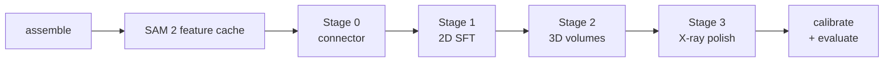

# Training Skanda on your own data

This guide covers the training mechanism behind Skanda-0 (stages, losses, what each stage trains) and how to run it on
your own images and masks. Everything here is the code in `skanda/`; nothing else is needed.

- [1. What gets trained](#1-what-gets-trained)
- [2. The loss](#2-the-loss)
- [3. Stages](#3-stages)
- [4. Your data: the record format](#4-your-data-the-record-format)
- [5. Running it](#5-running-it)
- [6. Calibration and evaluation](#6-calibration-and-evaluation)
- [7. Hardware and tips](#7-hardware-and-tips)

---

## 1. What gets trained

| Part | Source | Trained how |
|---|---|---|
| Vision encoder | Qwen3-VL-30B-A3B-Instruct | frozen in stage 0; LoRA on its last 11 of 27 blocks + mergers from stage 1 (`--vision-lora`) |
| Language model (MoE, 48 layers, ~3B active of 31B) | Qwen3-VL-30B-A3B-Instruct | frozen in stage 0; LoRA r=64 on attention q/k/v/o from stage 1; experts and router stay frozen |
| `[SEG]` token (id 151669) | already in Qwen3-VL's padded vocabulary | its input-embedding row and lm_head row train from stage 1, at 20× the learning rate; every other row's gradient is zeroed |
| `[SEG]` projector | new | MLP 2048 → 2048 → 256, from scratch, every stage |
| SAM 2.1 mask decoder (+ object score) | Sa2VA-Qwen3-VL-4B's SAM 2 | every stage |
| SAM 2.1 image encoder (Hiera-L) | Sa2VA-Qwen3-VL-4B's SAM 2 | frozen; its features are cached once (`skanda/cache_sam.py`) |
| Score head | new | linear 2048 → 1 + 13 on the last prompt token, every stage |

Why Sa2VA's SAM 2: it was already trained to take a language-model hidden state as its prompt, which is exactly the
interface Skanda uses. `skanda/assemble.py` copies its `grounding_encoder.*` weights (0 missing / 0 unexpected keys).

**How a `[SEG]` becomes an outline.** The model writes a JSON report. Every finding's `"mask"` field holds the token
`[SEG]`. In training, the language model's last-layer hidden state *at each `[SEG]` in the target* goes through the
projector into SAM 2's mask decoder as a sparse prompt, and the decoded mask is compared with the radiologist mask for
that finding. At inference (`skanda/infer.py`) the report is generated first, then one teacher-forced pass over prompt
+ reply reads the hidden state at the same positions, so training and inference see the same thing.

## 2. The loss

```
loss = text cross-entropy           reply tokens only; tokens that only spell the JSON skeleton × 0.3
     + 2.0 × mask BCE               per [SEG], 256 × 256, against the radiologist mask
     + 0.5 × mask Dice              (3D Dice over the supervised slices for volumes)
     + 0.2 × object-score BCE       SAM 2's "is something there" logit: 1 if the target mask is non-empty
     + 0.5 × score-head BCE         p(abnormal) + 13 chest X-ray classes; unknown labels (-1) are skipped
```

Code: `SkandaModel.forward` in `skanda/model.py`; the per-token weights come from `SkandaCollator` in
`skanda/data/dataset.py` (`BOILERPLATE`, `boiler_weight=0.3`). Weights are constructor arguments of `SkandaModel`
(`bce_weight`, `dice_weight`, `obj_weight`, `score_weight`).

- **Per-mask weights.** A record can set `"mask_weights": [w, …]` (one per `[SEG]`). 0 means "the text is right but
  the mask is not trustworthy": no BCE/Dice and an unknown object score for that finding.
- **Class balance.** Each record may carry `"sample_weight"`; the trainer draws records with probability proportional
  to it (`WeightedRandomSampler`). Skanda-0 used inverse square-root class frequency, so rare findings are seen more.
- **Score head targets.** From `"score"` in the record if present, else `abnormal = not target.normal`. Classes are
  `SCORE_CLASSES` in `skanda/model.py` (ChestX-Det's 13); CT/MRI records only train the abnormal column.
- **Optional asymmetric loss** for the score head (`--score-loss asl`, Ridnik et al., ICCV 2021) down-weights easy
  negatives so rare classes count more. Skanda-0 used BCE.

## 3. Stages



| Stage | Trains | Data | Skanda-0 settings |
|---|---|---|---|
| **0 · connector** | projector, mask decoder (the score head has no labels here) | "Outline the *right lung / heart / liver lesion* …" → `[SEG]` (`stage: "connector"` records), plus prompts for absent findings with an empty mask, which teach the object score 0 | lr 1e-4, 2 epochs |
| **1 · 2D SFT** | + LoRA (language model and vision encoder), `[SEG]` rows | full reports on X-rays and CT/MRI slices | lr 5e-5, LoRA r=64, `--vision-lora`; 2 epochs, then 1 more with `--hints` |
| **2 · 3D volumes** | same | CT/MRI stacks (33 slices) with 40% 2D replay (`--replay-frac 0.4`) | lr 5e-5; 3 epochs, then 1 more with `--hints` |
| **3 · X-ray polish** | same | X-ray reports with 15% 3D replay | lr 1.5e-5 (0.3×), 1 epoch |

#### Exact recipe of the published Skanda-0

Skanda-0 is the `polish` checkpoint of the third training run. Its weights went through six training passes in two runs.
Run 2 started from the base models, and run 3 continued from run 2's final checkpoint. Every pass below was kept by the
check.

| # | Run | Stage | Started from | Train data | Epochs | lr | Notes |
|---:|---|---|---|---|---:|---:|---|
| 1 | 2 | 0 · connector | Qwen3-VL-30B-A3B + Sa2VA's SAM 2 + new projector and score head | outline prompts: ChestX-Det findings and CheXmask lungs/heart; MSD lesions and organs (brain tumour, heart, liver, prostate, lung, pancreas, hepatic vessel, spleen, colon); ISLES 2022; 3,000 prompts for findings that are absent (empty mask) | 2 | 1e-4 | language model frozen |
| 2 | 2 | 1 · 2D SFT | pass 1 | reports: ChestX-Det, NIH ChestX-ray14, MSD, ISLES 2022, DeepLesion, autoPET | 2 | 5e-5 | LoRA r=64 + vision LoRA, `[SEG]` rows |
| 3 | 2 | 2 · 3D | pass 2 | MSD, ISLES and autoPET volumes, with and without lesions; 40% 2D replay of pass 2's data | 3 | 5e-5 | |
| 4 | 3 | 1 · 2D SFT | pass 3 | as pass 2, with X-ray targets rebuilt: one finding + `[SEG]` per radiologist outline, and NIH rare-label films with text-only reports | 1 | 5e-5 | + hint lines (`--hints`) |
| 5 | 3 | 2 · 3D | pass 4 | as pass 3 | 1 | 5e-5 | hints |
| 6 | 3 | 3 · X-ray polish | pass 5 | ChestX-Det + NIH reports; 15% replay of the volumes | 1 | 1.5e-5 | hints → **Skanda-0** |

After pass 6, the abnormal-score gate (`skanda/calibrate.py`) and the hint thresholds (`skanda/calibrate_hints.py`)
were chosen on validation records and dev films and written into `skanda_config.json`.

**The check.** After every pass, a score is computed on dev films and validation records, never on test data:
0.35 × X-ray balanced accuracy + 0.15 × right finding type + 0.15 × X-ray box recall + 0.20 × CT/MRI balanced
accuracy + 0.15 × CT/MRI outline recall. A pass is kept when its score is at least the best so far − 0.01.
Skanda-0 scored 0.616 (run 2's best: 0.598). An earlier run 1 also had a GRPO stage, which made the model call every
X-ray abnormal; run 2's GRPO stage was dropped by this check, and run 3 did not run one.

Shared: batch 1 × gradient accumulation 8, AdamW (weight decay 0), OneCycle with 3% warm-up, grad-clip 1.0, bf16
autocast, gradient checkpointing, images up to 1024² for both Qwen3-VL and SAM 2 (`--max-pixels`), volume slices at
320² for Qwen3-VL (`--stack-pixels`).

- **Stage 2 (volumes).** All 33 slices (32 evenly spaced + the key slice) go to Qwen3-VL at low resolution. Each `[SEG]`
  is decoded by SAM 2 on up to 10 slices: the key slice, slices with lesion, and 2 lesion-free slices, so the Dice is a
  3D Dice and the object score learns where a lesion ends (`SkandaVolumeCollator`).
- **Replay.** `--replay` mixes 2D records into a stage-2 run at `--replay-frac` of the draws. Without it, a model
  trained only on lesion volumes learns to call everything abnormal.
- **Hints (`--hints`).** X-ray replies start with a short noisy "likely / possible …" line built from the labels
  (`skanda/hints.py`); it is input, not a loss target. At inference the score head writes it (thresholds from
  `skanda/calibrate_hints.py`).
- **Keep only what helps.** After every stage Skanda-0 computed one score on dev and validation data and kept the
  stage only if it was within 0.01 of the best so far (details below).
- **Resumable.** Every `--ckpt-minutes` (and at each validation) the trainable weights, optimiser and scheduler are
  written atomically to `<out>/ckpt`; re-running the same command continues from there.

## 4. Your data: the record format

Training data is JSON Lines, one record per line. Image and mask paths are absolute or relative to the working
directory. `skanda/data/build_cxr.py` (ChestX-Det) and `skanda/data/build_msd.py` (any Medical Segmentation
Decathlon-style NIfTI task) are complete worked examples.

### 2D report record (X-ray, or one CT/MRI slice)

```json
{
  "id": "case_0001",
  "stage": "sft",
  "modality": "cxr",
  "images": ["data/mine/images/case_0001.png"],
  "system": "<skanda.templates.SYSTEM>",
  "prompt": "Read this chest radiograph. Reply as JSON: normal, findings (title, evidence, location, severity, mask), impression.",
  "target": "{\"normal\": false, \"findings\": [{\"title\": \"Effusion, right\", \"evidence\": \"Homogeneous opacity at the right costophrenic angle ...\", \"location\": \"right lower zone\", \"severity\": \"moderate\", \"mask\": \"[SEG]\"}], \"impression\": \"Right pleural effusion.\"}",
  "masks": ["data/mine/masks/case_0001_0.png"],
  "source": "my-hospital",
  "sample_weight": 1.0
}
```

| Field | Meaning |
|---|---|
| `images` | one image; Qwen3-VL reads it, and SAM 2 reads the first image at 1024² |
| `target` | the reply, a JSON **string** in the `skanda-report/2` format below |
| `masks` | one binary PNG per `[SEG]` in `target`, **in the same order**; any size, >127 = inside |
| `modality` | `cxr`, `ct` or `mri` (used for hints, balancing and per-modality metrics) |
| `source` | dataset id, checked against `skanda/registry.py` by the builders |
| optional | `sample_weight`, `mask_weights`, `score` (`{"abnormal": 0/1, "<class>": 0/1}`), `labels` |

A normal image has `"normal": true`, an empty findings list and `"masks": []`. Normal images matter: Skanda-0 mixes in
normal films and lesion-free CT/MRI slices so it learns to say "normal".

**Label-only record.** `"target": null` and `"masks": []` with a `"score"` dict: no text loss, the score head only.

### `skanda-report/2`

```json
{"normal": false,
 "findings": [{"title": "...", "evidence": "...", "location": "...", "severity": "minor|moderate|significant|critical", "mask": "[SEG]"}],
 "impression": "..."}
```

Skanda-0's evidence text is never free text written by a model: every number (side, zone, extent, diameter in mm,
volume in mL, HU) is measured from the radiologist mask (`skanda/measure.py`) and put into fixed sentences
(`skanda/templates.py`). Doing the same for your data keeps the outline and the text consistent.

### Connector record (stage 0)

```json
{"id": "case_0001#heart", "stage": "connector", "modality": "cxr", "images": ["..."], "system": "...",
 "prompt": "Outline the patient's heart on this chest radiograph.", "target": "[SEG]", "masks": ["...heart.png"]}
```

Use anatomy and lesion masks you already have; a few thousand are enough to teach the projector what `[SEG]` means.

### 3D volume record (stage 2)

```json
{"id": "vol_0001", "stage": "stack", "modality": "ct",
 "images": ["stacks/vol_0001/z0000.png", "... 33 slice PNGs ..."],
 "key_slice": 22,
 "masks_npz": "stacks/vol_0001/masks.npz",
 "system": "...", "prompt": "Read these axial slices of an abdomen CT. ... Give the key slice number in each finding's location.",
 "target": "{\"normal\": false, \"findings\": [...], \"impression\": \"...\"}"}
```

`masks.npz` holds `masks`: bool `[n_findings, n_slices, H, W]`, finding order = `[SEG]` order. A lesion-free volume
has zero findings. `build_msd.py` shows the slice choice (32 evenly spaced + key slice) and rendering: CT as three
windows (lung / soft tissue / bone) in R / G / B, MRI as up to three sequences, patient right on image left.

### Splits and licences

- Split **by patient**, never by image, and keep a test split you never train or calibrate on.
- `skanda/registry.py` is a licence gate: builders call `require(source)` and refuse datasets whose licence does not
  allow your intended use. Add your dataset there with its licence.

## 5. Running it

Fine-tuning from Skanda-0 is the cheapest start: the connector is already trained, so skip stage 0.

```bash
pip install -r requirements.txt
hf download hitheshkaranth/Skanda-0 --local-dir checkpoints/skanda-0
hf download ByteDance/Sa2VA-Qwen3-VL-4B --local-dir checkpoints/sa2va          # SAM 2 weights for the feature cache

# SAM 2 features for every 2D training/validation image (frozen encoder, ~8 MB per image, resumable)
python -I skanda/cache_sam.py --sa2va checkpoints/sa2va --data data/mine/sft_*.jsonl --out cache/sam

# 2D SFT on your data (add Skanda's own data or replay if you want to keep its other skills)
python -I skanda/train.py --init checkpoints/skanda-0 --stage 1 --train data/mine/sft_train.jsonl \
    --val data/mine/sft_val.jsonl --out runs/stage1 --sam-cache cache/sam --vision-lora --hints --epochs 1
# volumes, with 40% 2D replay
python -I skanda/train.py --init runs/stage1/final --stage 2 --train data/mine/stack_train.jsonl \
    --replay data/mine/sft_train.jsonl --replay-frac 0.4 --val data/mine/stack_val.jsonl --out runs/stage2 \
    --sam-cache cache/sam --vision-lora --hints
```

From scratch (the base models only):

```bash
python -I skanda/assemble.py --sa2va checkpoints/sa2va --out models/skanda-init      # Qwen3-VL + SAM 2 + new projector
python -I skanda/cache_sam.py --sa2va checkpoints/sa2va --data data/mine/connector_*.jsonl data/mine/sft_*.jsonl --out cache/sam
python -I skanda/train.py --init models/skanda-init --stage 0 --train data/mine/connector_train.jsonl \
    --val data/mine/connector_val.jsonl --out runs/stage0 --sam-cache cache/sam --epochs 2 --eval-every 600
python -I skanda/train.py --init runs/stage0/final --stage 1 ...   # then stages 1, 2 and polish as above
# X-ray polish: stage-2 code path with X-ray reports as train and volumes as 15% replay, 0.3x learning rate
python -I skanda/train.py --init runs/stage2/final --stage 2 --train data/mine/cxr_sft_train.jsonl \
    --replay data/mine/stack_train.jsonl --replay-frac 0.15 --val data/mine/sft_val.jsonl --out runs/polish \
    --sam-cache cache/sam --vision-lora --hints --lr 1.5e-5
```

Each stage writes `<out>/metrics.jsonl` (loss parts, learning rate, seconds per step, validation) and a merged
checkpoint in `<out>/final` (`vlm/`, `skanda_heads.pt`, `skanda_config.json`), which is what `--init`,
`skanda/evaluate.py` and `skanda/serve.py` load. `python -I skanda/tests/smoke_cpu.py --sa2va checkpoints/sa2va --data
<records>` runs one training step on a tiny random backbone on CPU to check your records before a long run.

## 6. Calibration and evaluation

```bash
# raw reads on validation records, then the per-modality abnormal-score gate written into the checkpoint
python -I skanda/evaluate.py --model runs/polish/final --data data/mine/sft_val.jsonl --out runs/calib --no-gate
python -I skanda/calibrate.py --results runs/calib/results.jsonl --model runs/polish/final
# X-ray hint thresholds (validation data only, never test)
python -I skanda/calibrate_hints.py --model runs/polish/final --data data/mine/sft_val.jsonl
# the benchmark on held-out test records
python -I skanda/evaluate.py --model runs/polish/final --data data/mine/sft_test.jsonl data/mine/stack_test.jsonl --out runs/eval
```

`evaluate.py` reports, per modality: valid JSON, abnormal flagged, normals called normal, outline recall and precision
(a radiologist mask is found when a predicted mask overlaps it at IoU ≥ 0.3, matched one-to-one), Dice of found
outlines, and whether the finding type and side agree. It is resumable and `--summary` re-prints the table.

## 7. Hardware and tips

- Skanda-0 was trained on one NVIDIA DGX Spark (GB10, 128 GB unified memory): ~80 GB for stage 1 with cached SAM
  features. One 80 GB GPU should fit; smaller GPUs need a smaller backbone or offloading.
- Inference needs ~68 GB in bf16; `skanda/quant.py` builds int8 (~31 GB) or int4 (~17 GB) weight-only versions.
  Re-run the two calibration steps after quantizing.
- Seconds per step: ~14 s (2D), ~35 s (volumes) on the Spark. `--limit N` trains on the first N records for a dry run.
- Checks that mattered most: patient-level splits, normal cases in every stage, replay whenever a stage changes the
  data mix, and evaluating every stage against the previous best before keeping it.
